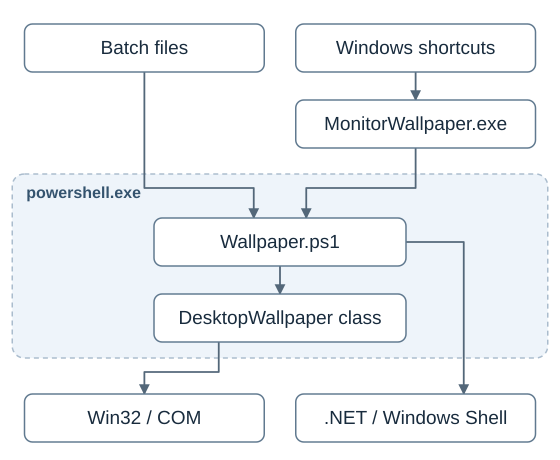
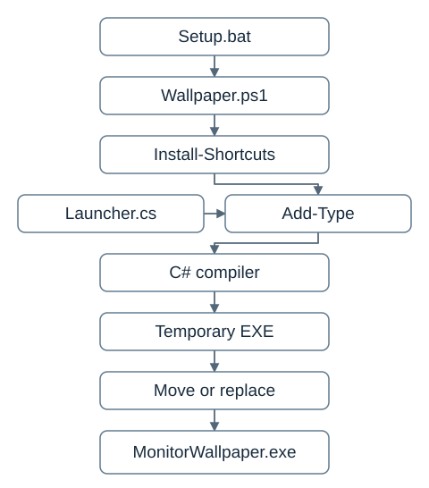
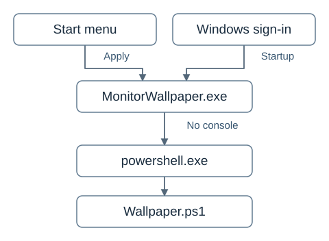
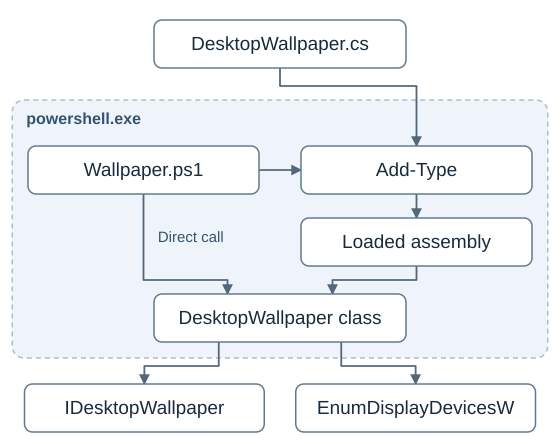

# Monitor Wallpaper アーキテクチャ

モニターごとに壁紙をランダムに変更する Windows 10 / 11 向けツール。PowerShell が処理全体を管理し、C# がコンソールを表示しないランチャーと Windows API / COM との連携を担う。

## 1. 実行時のアーキテクチャ（Runtime Architecture）



実行に関わる7つのファイルと、生成物や OS の機能を示す。実線の矢印は起動・呼び出し・参照、破線の矢印はビルド・コンパイルを表す。破線の枠は C# ソースまたは設定ファイルを示す。

バッチファイルとランチャーは Windows PowerShell 5.1（`powershell.exe`）を起動する。

| 層 | モジュール | 役割 |
| --- | --- | --- |
| ユーザーインターフェース | [Setup.bat](Setup.bat) | Setup を実行し、終了コードを返す |
| ユーザーインターフェース | [Reroll.bat](Reroll.bat) | Apply を実行し、終了コードを返す |
| ユーザーインターフェース | [StopStartup.bat](StopStartup.bat) | StopStartup を実行し、終了コードを返す |
| ユーザーインターフェース | [Launcher.cs](internal/Launcher.cs) | MonitorWallpaper.exe のソース。コンソールを表示せずに PowerShell を起動する |
| アプリケーションロジック | [Wallpaper.ps1](internal/Wallpaper.ps1) | Action の振り分け、設定の読み込み、画像選択、ショートカット管理、排他制御、ログ出力 |
| Windows 連携 | [DesktopWallpaper.cs](internal/DesktopWallpaper.cs) | モニターの識別、壁紙の取得・設定 |
| 設定 | [config.txt](config.txt) | モニターごとの変更方法（random / keep）と画像フォルダーを指定する |
| Windows 連携 | .NET / Windows Shell | ファイル操作、名前付き Mutex、WScript.Shell (COM) によるショートカット管理 |

### コンパイルと実行のタイミング

| ファイル | 言語 | コンパイル・実行のタイミング | 生成物 |
| --- | --- | --- | --- |
| Wallpaper.ps1 | PowerShell | 起動するたびに読み込んで実行（事前ビルド不要） | 永続的なビルド成果物なし |
| Launcher.cs | C# | Setup 時にコンパイル。ショートカットからの起動時はビルド済みの EXE を実行 | MonitorWallpaper.exe |
| DesktopWallpaper.cs | C# | Apply / Startup 時に必要に応じてコンパイルし、PowerShell プロセス内で実行 | メモリ上のアセンブリ |

C# のコンパイルは `Wallpaper.ps1` が管理する。`Launcher.cs` を変更した場合は Setup.bat の再実行が必要。`Wallpaper.ps1` は次回実行時、`DesktopWallpaper.cs` は次回の壁紙変更処理時に変更が反映される。

### Action と起動元

| Action | 起動元 | 処理内容 |
| --- | --- | --- |
| Setup | [Setup.bat](Setup.bat) | 設定と画像フォルダーを確認し、ランチャーをビルドしてショートカットを登録する。対応する旧版のスタートアップ登録も削除する |
| Apply | [Reroll.bat](Reroll.bat)、スタートメニューのショートカット | random に設定されたモニターの壁紙を変更する |
| Startup | スタートアップのショートカット | サインイン時に壁紙を変更する。対象モニターが見つからない場合は、約20秒を上限に再取得を試みる（API の処理時間などを除く） |
| StopStartup | [StopStartup.bat](StopStartup.bat) | 対応するランチャーを参照する現行版・旧版のスタートアップショートカットを削除する。手動起動用のショートカットと EXE は残す |

4つの Action は `Wallpaper.ps1` 内で処理を切り替える。Setup では壁紙を変更しない。Apply と Startup は壁紙変更処理を共有し、keep に設定したモニターや設定にないモニターは変更しない。Apply / Startup では、すべて keep の場合は DesktopWallpaper.cs をコンパイルしない。

## 2. ビルド時のアーキテクチャ（Build Architecture）

Setup 時に利用者の PC でランチャーをビルドする。Windows PowerShell 5.1 のコンパイル機能を使うため、Visual Studio や追加の .NET SDK は不要。



Windows PowerShell 5.1 は .NET Framework の C# コンパイル機構を利用する。生成される EXE は Windows GUI アプリケーションであり、CIL（中間言語）と型情報などを含む。実行時に CLR が必要なメソッドを JIT コンパイルする。

Wallpaper.ps1 のビルド処理：

```powershell
Add-Type -LiteralPath (Join-Path $PSScriptRoot 'Launcher.cs') `
    -ReferencedAssemblies 'System.Windows.Forms.dll' `
    -OutputAssembly $temporaryLauncher `
    -OutputType WindowsApplication
```

| オプション | 役割 |
| --- | --- |
| LiteralPath | C# ソースファイルの指定 |
| ReferencedAssemblies | 警告ダイアログに使う Windows Forms の参照 |
| OutputAssembly | 一意な名前の一時 EXE の出力 |
| OutputType | Windows GUI アプリケーション形式の指定 |

Setup は一時 EXE を正式な配置先に移動または置換し、WScript.Shell でスタートメニューとスタートアップのショートカットを作成する。どちらも MonitorWallpaper.exe を起動し、Wallpaper.ps1 の絶対パスと Action を渡す。

### ランチャーの起動経路



ランチャーは Process.Start で PowerShell を起動する。UseShellExecute を false、CreateNoWindow を true に設定し、スクリプト独自の Hidden スイッチも渡す。

子プロセスの終了を待たないため、壁紙変更の終了コードは取得しない。起動に失敗した場合は Apply のときだけ警告を表示し、スクリプト内のエラーは Wallpaper.ps1 が処理する。

## 3. 実行時コンパイル（In-memory Compilation）

Apply または Startup で壁紙を変更する際、DesktopWallpaper.cs をコンパイルする。

**PowerShell と C# は同じ .NET ランタイム（CLR）を利用するため、C# を EXE にして別プロセスで起動しなくても、PowerShell からクラスのインスタンスを生成し、メソッドを直接呼び出せる。**

Add-Type でコンパイルしたアセンブリを実行中の powershell.exe に読み込む。メソッドの呼び出しは同じプロセス内で行うため、両者間の IPC（プロセス間通信）は不要。



Wallpaper.ps1 の読み込み・呼び出し処理：

```powershell
Add-Type -LiteralPath (Join-Path $PSScriptRoot 'DesktopWallpaper.cs')
$desktop = [MyTools.MonitorWallpaper.DesktopWallpaper]::new()
$monitors = $desktop.GetMonitors()
```

壁紙の変更には `$desktop.SetWallpaper($monitor.Id, $image.FullName)` を使う。CLR はアセンブリ内の CIL を必要に応じて JIT コンパイルする。壁紙変更用の EXE や DLL は保存しないが、コンパイラが一時ファイルや別プロセスを利用する場合はある。

C# は P/Invoke で user32.dll の EnumDisplayDevicesW を呼び出し、モニターのデバイスパスを照合する。COM の IDesktopWallpaper で壁紙を取得・設定し、処理終了時に Dispose() で COM オブジェクトを解放する。

## 4. 共有リソースと排他制御

すべての Action は主処理の前に同じ名前付き Mutex（`Local\Freely.MonitorWallpaper`）の取得を試みる。同じ Windows セッション内で、この Mutex を使う処理の同時実行を防ぐ。

30秒以内に取得できなければ異常終了する。取得後は処理とログ出力が終わるまでロックを保持し、finally で解放する。他の壁紙アプリの動作は制限しない。

旧版との排他制御の互換性を保つため、Mutex 名は変更していない。

| リソース | 保存先・動作 |
| --- | --- |
| 既定の設定 | [config.txt](config.txt) |
| ローカル設定 | config.local.txt があれば優先して読み込む |
| ランチャー | `%LOCALAPPDATA%\MyTools\MonitorWallpaper\MonitorWallpaper.exe` |
| 実行ログ | 同じフォルダーの last-reroll.txt（Apply）、last-startup.txt（Startup）。Mutex を取得した場合に更新する |
| ショートカット | 現在のユーザーのスタートメニューとスタートアップフォルダー |

ショートカットは Setup を実行したフォルダーを参照する。ツールを移動した場合は、移動先の Setup.bat で登録を更新する。
