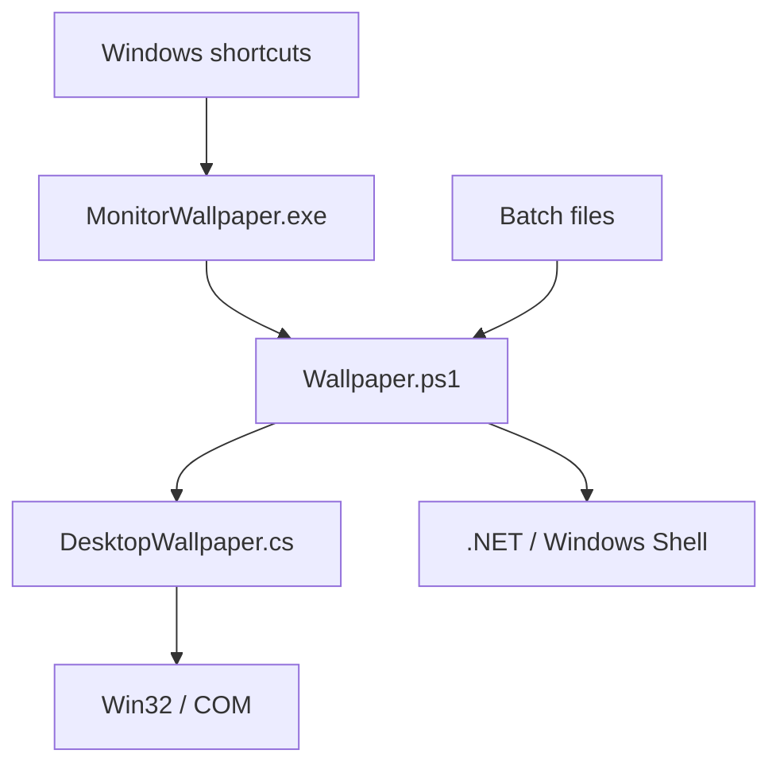
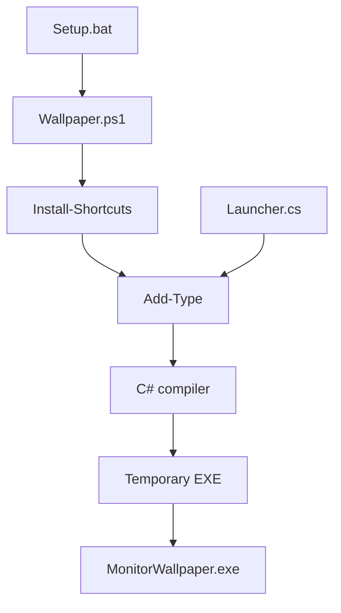
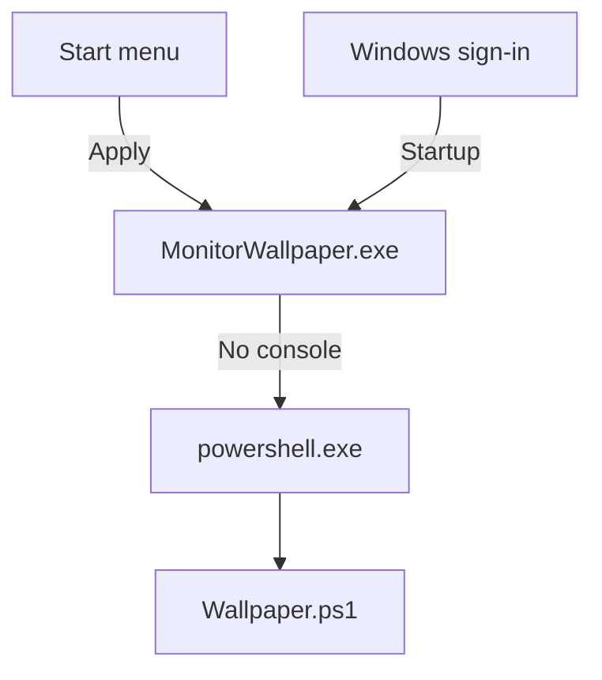
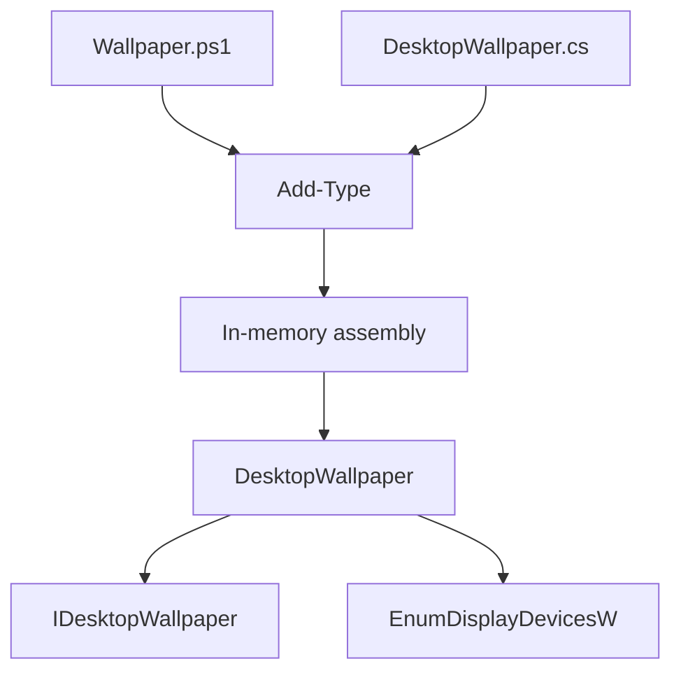

# Monitor Wallpaper アーキテクチャ

モニターごとに壁紙をランダムに変更する Windows 10 / 11 向けユーティリティ。PowerShell がアプリケーション本体を担い、C# はコンソール非表示のランチャーと Windows API / COM 連携の2つの用途で利用する。

## 1. 実行時のアーキテクチャ（Runtime Architecture）



矢印は主な起動経路および依存関係を示す。バッチファイルとランチャーは Windows PowerShell 5.1（powershell.exe）を起動する。Wallpaper.ps1 はそのプロセス内で実行され、必要な場合に DesktopWallpaper.cs をコンパイルして読み込む。ランチャーはコンソールを表示せず、子プロセスの終了を待たないため、壁紙変更の終了コードは取得しない。

| 層 | モジュール | 責務 |
| --- | --- | --- |
| ユーザーインターフェース | バッチファイル | PowerShell の起動、終了コードの伝搬 |
| ユーザーインターフェース | [Launcher.cs](internal/Launcher.cs) | コンソールを表示せずに PowerShell を起動する。MonitorWallpaper.exe としてビルドされる。 |
| アプリケーションロジック | [Wallpaper.ps1](internal/Wallpaper.ps1) | Action の振り分け、設定の読み込み、画像選択、ショートカット管理、排他制御、実行結果の記録 |
| Windows 連携 | [DesktopWallpaper.cs](internal/DesktopWallpaper.cs) | モニターの識別、壁紙の取得・設定。EnumDisplayDevicesW と IDesktopWallpaper を利用する。 |
| Windows 連携 | .NET / Windows Shell | ファイル操作、名前付き Mutex、WScript.Shell (COM) によるショートカット管理 |

### Action の起動経路

| 起動元 | Action |
| --- | --- |
| [Setup.bat](Setup.bat) | Setup |
| [Reroll.bat](Reroll.bat) | Apply |
| [StopStartup.bat](StopStartup.bat) | StopStartup |
| スタートメニューのショートカット | Apply |
| スタートアップのショートカット | Startup |

4 種類の Action は独立したスクリプトではなく、Wallpaper.ps1 内の処理分岐である。Setup は登録のみを行い、その場で壁紙を変更しない。Apply と Startup は共通の壁紙変更処理を利用し、keep の画面と設定にない画面は変更しない。すべて keep の場合は C# のコンパイルも行わない。

| Action | 責務 |
| --- | --- |
| Setup | 設定と画像フォルダーを検証し、ランチャーをビルドしてショートカットを登録する。対象が一致する旧版のスタートアップ登録も削除する。 |
| Apply | random に設定されたモニターの壁紙を変更する。 |
| Startup | Windows サインイン時に壁紙を変更する。対象のモニターが未認識の場合は約 20 秒を上限に再取得を試みる（API 呼び出し時間などを除く）。 |
| StopStartup | 対応するランチャーを指している現行版・旧版のスタートアップショートカットのみ削除する。手動起動用のショートカットと EXE は維持する。 |

## 2. ビルド時のアーキテクチャ（Build Architecture）

Setup の実行時に、利用者の PC 上でランチャーをビルドする。Windows PowerShell 5.1 の機能を利用するため、Visual Studio や別途 .NET SDK をインストールする必要はない。



Windows PowerShell 5.1 は .NET Framework の C# コンパイル機構を利用する。生成されるランチャーは、コンソールアプリケーションではなく、マネージドコードの Windows GUI アプリケーションである。EXE には CIL（中間言語）と型情報などが含まれ、実行時に CLR が必要なメソッドを JIT コンパイルする。

Wallpaper.ps1 内のビルド処理は以下のとおり。

```powershell
Add-Type -LiteralPath (Join-Path $PSScriptRoot 'Launcher.cs') `
    -ReferencedAssemblies 'System.Windows.Forms.dll' `
    -OutputAssembly $temporaryLauncher `
    -OutputType WindowsApplication
```

| ビルドオプション | 役割 |
| --- | --- |
| LiteralPath | コンパイル対象の C# ソースファイルを指定する。 |
| ReferencedAssemblies | 警告ダイアログの表示に必要な Windows Forms を参照する。 |
| OutputAssembly | 一意な名前の一時 EXE ファイルを出力する。 |
| OutputType | Windows GUI アプリケーション形式で生成する。 |

Setup は一時 EXE を正式な配置先へ移動または置換した後、WScript.Shell を利用してスタートメニューとスタートアップのショートカットを生成する。どちらも MonitorWallpaper.exe を起動し、Wallpaper.ps1 の絶対パスと対応する Action を引数として渡す。

### インストール済みランチャーの起動経路



ランチャーは Process.Start を使用し、UseShellExecute を false、CreateNoWindow を true に設定して PowerShell を起動する。また、スクリプト独自の Hidden スイッチを渡す。起動失敗時は Apply の場合のみ警告を表示する。スクリプト内部のエラーは Wallpaper.ps1 側で処理する。

## 3. 実行時コンパイルと同一プロセス内での呼び出し（In-memory Compilation）

Apply または Startup で壁紙変更が必要な場合、DesktopWallpaper.cs を実行時にコンパイルする。

**PowerShell と C# は共通の .NET ランタイム（CLR）を利用するため、C# のクラスを EXE にして別プロセスとして起動しなくても、PowerShell から直接生成・呼び出しできる。** 今回は Add-Type でコンパイルしたアセンブリを実行中の powershell.exe にロードしており、PowerShell と C# のメソッド呼び出しは同じプロセス内で完結する。両者間の IPC（プロセス間通信）は不要である。



実際の Wallpaper.ps1 では次のようにクラスを読み込み、インスタンスを生成している。

```powershell
Add-Type -LiteralPath (Join-Path $PSScriptRoot 'DesktopWallpaper.cs')
$desktop = [MyTools.MonitorWallpaper.DesktopWallpaper]::new()
$monitors = $desktop.GetMonitors()
```

壁紙の変更時は `$desktop.SetWallpaper($monitor.Id, $image.FullName)` を呼び出す。C# のアセンブリには CIL と型情報などが含まれ、CLR が必要なメソッドを JIT コンパイルして実行する。壁紙変更専用の独立した EXE や永続的な DLL は生成しない。ただし、コンパイラ内部の一時ファイルやコンパイラプロセスまで存在しないという意味ではない。

C# 側は P/Invoke により user32.dll の EnumDisplayDevicesW を呼び出し、COM の IDesktopWallpaper を通して壁紙を取得・設定する。モニターのデバイスパスを照合して対象を特定する。壁紙変更処理が終わると Dispose() で COM オブジェクトを解放する。

| 比較項目 | Launcher.cs | DesktopWallpaper.cs |
| --- | --- | --- |
| コンパイル時期 | Setup | Apply または Startup（必要時） |
| 生成物 | Windows GUI アプリケーション（EXE） | メモリ上のアセンブリ |
| 実行形態 | 独立したプロセス | PowerShell プロセス内 |
| 目的 | PowerShell の起動 | Windows API / COM の操作 |

## 4. 共有リソースと排他制御

すべての Action は、主処理に入る前に同じ名前付き Mutex（`Local\Freely.MonitorWallpaper`）の取得を試みる。同一 Windows セッション内で、同じ Mutex を使用するプロセスの主処理の同時実行を防ぐ。取得後は壁紙変更時のログ書き込みまでロックを保持し、finally で解放する。取得待ちのタイムアウトは 30 秒であり、取得できなければ主処理を実行せず異常終了する。別の壁紙アプリなど、同じ Mutex を使わない処理は制限しない。

旧版のツールとの排他制御の互換性を維持するため、Mutex 名は意図的に旧版の名称を使用している。

| リソース | 保存先・動作 |
| --- | --- |
| 既定の設定 | [config.txt](config.txt) |
| ローカル設定 | config.local.txt が存在する場合は優先する。 |
| インストール済みランチャー | `%LOCALAPPDATA%\MyTools\MonitorWallpaper\MonitorWallpaper.exe` |
| 実行ログ | Apply / Startup がロックを取得した場合に、同じデータフォルダーの last-reroll.txt / last-startup.txt をそれぞれ更新する。 |
| ショートカット | 現在のユーザーのスタートメニューとスタートアップフォルダー |

ショートカットは Setup を実行したフォルダーを参照する。ツールを移動した場合は、移動先で Setup.bat を実行して登録を更新する。
