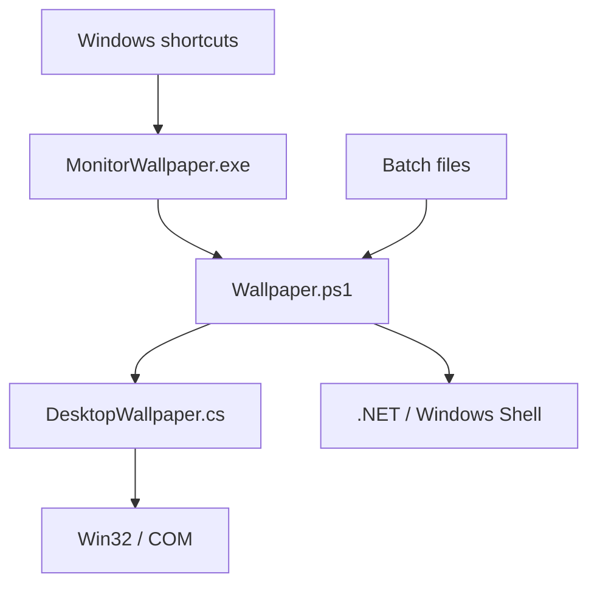
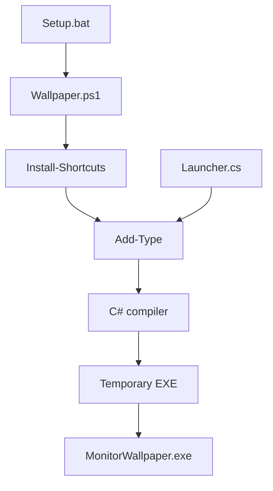
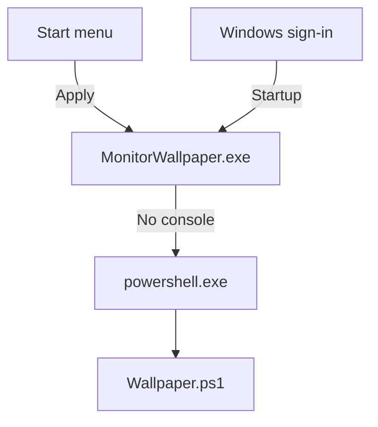
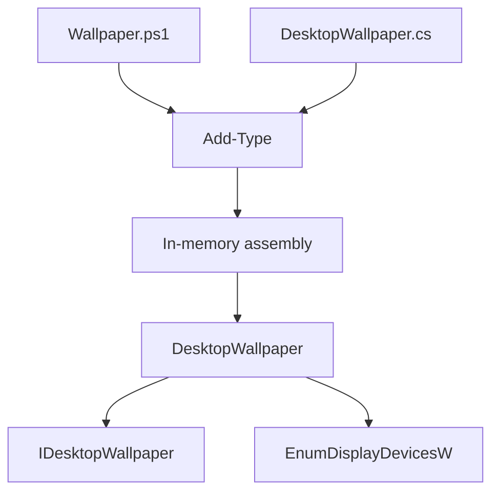

# Monitor Wallpaper アーキテクチャ

モニターごとに壁紙をランダムに変更する Windows 向けユーティリティ。

## 1. 実行時のアーキテクチャ（Runtime Architecture）



矢印は主な起動経路および依存関係を示す。バッチファイルとランチャーは Windows PowerShell 5.1 を起動する。ランチャーはコンソールを表示せず、子プロセスの終了を待たない。

| 層 | モジュール | 責務 |
| --- | --- | --- |
| ユーザーインターフェース | バッチファイル | PowerShell の起動、終了コードの伝搬 |
| ユーザーインターフェース | [Launcher.cs](internal/Launcher.cs) | コンソールを表示せずに PowerShell を起動する。MonitorWallpaper.exe としてビルドされる。 |
| アプリケーションロジック | [Wallpaper.ps1](internal/Wallpaper.ps1) | Action の振り分け、設定の読み込み、画像選択、ショートカット管理、排他制御、実行結果の記録 |
| Windows 連携 | [DesktopWallpaper.cs](internal/DesktopWallpaper.cs) | モニターの識別、壁紙の取得・設定。EnumDisplayDevicesW と IDesktopWallpaper を利用する。 |
| Windows 連携 | .NET / Windows Shell | ファイル操作、名前付き Mutex、WScript.Shell (COM) によるショートカット管理 |

### Action の起動経路

| 起動元 | Action |
| --- | --- |
| [Setup.bat](Setup.bat) | Setup |
| [Reroll.bat](Reroll.bat) | Apply |
| [StopStartup.bat](StopStartup.bat) | StopStartup |
| スタートメニューのショートカット | Apply |
| スタートアップのショートカット | Startup |

4 種類の Action は独立したスクリプトではなく、Wallpaper.ps1 内の処理分岐である。

| Action | 責務 |
| --- | --- |
| Setup | 設定と画像フォルダーを検証し、ランチャーをビルドしてショートカットを登録する。対象が一致する旧版のスタートアップ登録も削除する。 |
| Apply | random に設定されたモニターの壁紙を変更する。 |
| Startup | Windows サインイン時に壁紙を変更する。未認識のモニターがある場合は最大 20 秒間待機する。 |
| StopStartup | 対応するランチャーを指している現行版・旧版のスタートアップショートカットのみ削除する。手動起動用のショートカットと EXE は維持する。 |

## 2. ビルド時のアーキテクチャ（Build Architecture）

Setup の実行時に、利用者の PC 上でランチャーをビルドする。Windows PowerShell 5.1 の機能を利用するため、Visual Studio や別途 .NET SDK をインストールする必要はない。



Windows PowerShell 5.1 は .NET Framework の C# コンパイル機構を利用する。生成されるランチャーは、コンソールアプリケーションではなく、マネージドコードの Windows GUI アプリケーションである。

Wallpaper.ps1 内のビルド処理は以下のとおり。

```powershell
Add-Type -LiteralPath (Join-Path $PSScriptRoot 'Launcher.cs') `
    -ReferencedAssemblies 'System.Windows.Forms.dll' `
    -OutputAssembly $temporaryLauncher `
    -OutputType WindowsApplication
```

| ビルドオプション | 役割 |
| --- | --- |
| LiteralPath | コンパイル対象の C# ソースファイルを指定する。 |
| ReferencedAssemblies | 警告ダイアログの表示に必要な Windows Forms を参照する。 |
| OutputAssembly | 一意な名前の一時 EXE ファイルを出力する。 |
| OutputType | Windows GUI アプリケーション形式で生成する。 |

Setup は一時 EXE を正式な配置先へ移動または置換した後、WScript.Shell を利用してスタートメニューとスタートアップのショートカットを生成する。どちらも MonitorWallpaper.exe を起動し、Wallpaper.ps1 の絶対パスと対応する Action を引数として渡す。

### インストール済みランチャーの起動経路



ランチャーは Process.Start を使用し、UseShellExecute を false、CreateNoWindow を true に設定して PowerShell を起動する。また、スクリプト独自の Hidden スイッチを渡す。

## 3. メモリ上でのコンパイル（In-memory Compilation）

Apply または Startup で壁紙変更が必要な場合、DesktopWallpaper.cs を別途コンパイルする。ランチャーとは異なり、コンパイルしたアセンブリは実行中の PowerShell プロセス内に読み込まれる。



PowerShell はコンパイルしたクラスのインスタンスを生成し、メソッドを直接呼び出す。壁紙変更専用の独立した EXE は生成しない。

| 比較項目 | Launcher.cs | DesktopWallpaper.cs |
| --- | --- | --- |
| コンパイル時期 | Setup | Apply または Startup（必要時） |
| 生成物 | Windows GUI アプリケーション（EXE） | メモリ上のアセンブリ |
| 実行形態 | 独立したプロセス | PowerShell プロセス内 |
| 目的 | PowerShell の起動 | Windows API / COM の操作 |

## 4. 共有リソースと排他制御

すべての Action は、主処理に入る前に同じ名前付き Mutex（`Local\Freely.MonitorWallpaper`）の所有権を取得する。同一 Windows セッション内での同時実行を防ぎ、壁紙変更時のログ書き込みまでロックを保持する。取得待ちのタイムアウトは 30 秒である。

旧版のツールとの排他制御の互換性を維持するため、Mutex 名は意図的に旧版の名称を使用している。

| リソース | 保存先・動作 |
| --- | --- |
| 既定の設定 | [config.txt](config.txt) |
| ローカル設定 | config.local.txt が存在する場合は優先する。 |
| インストール済みランチャー | `%LOCALAPPDATA%\MyTools\MonitorWallpaper\MonitorWallpaper.exe` |
| 実行ログ | 同じデータフォルダー内の last-reroll.txt、last-startup.txt |
| ショートカット | 現在のユーザーのスタートメニューとスタートアップフォルダー |

ショートカットは Setup を実行したフォルダーを参照する。ツールを移動した場合は、移動先で Setup.bat を実行して登録を更新する。
