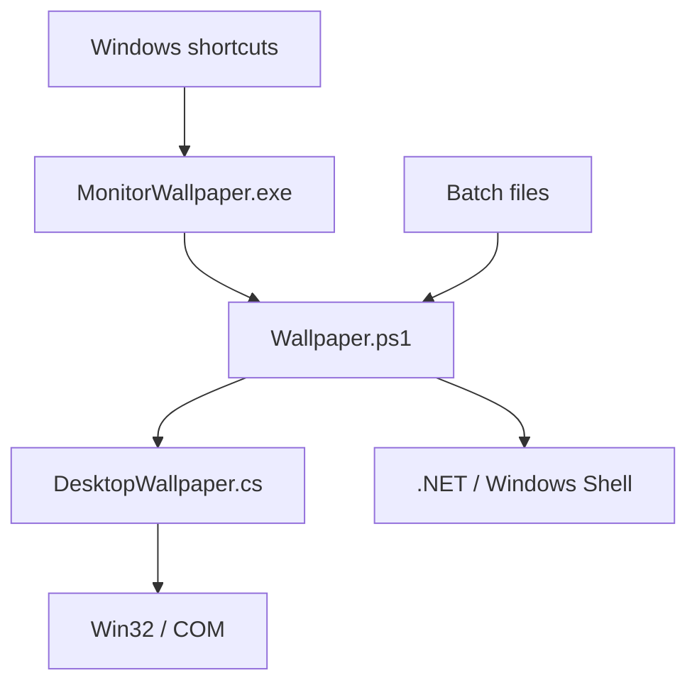
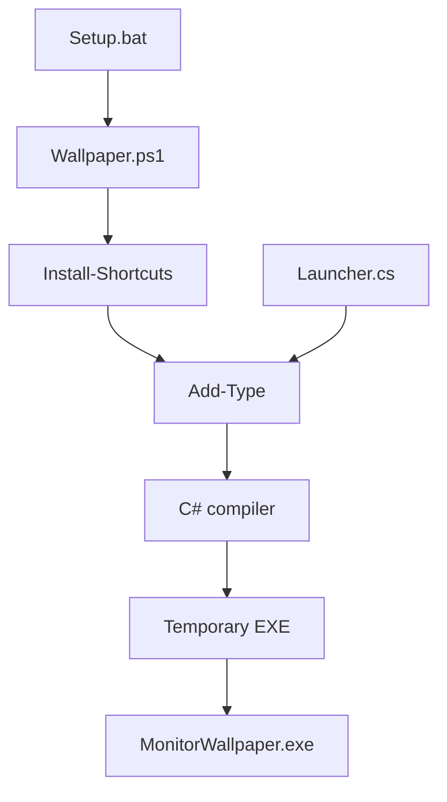
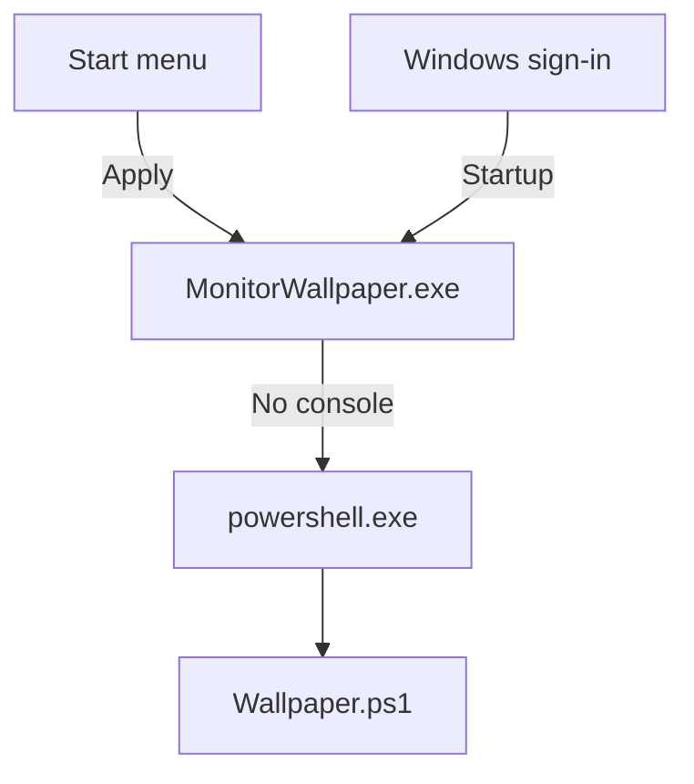
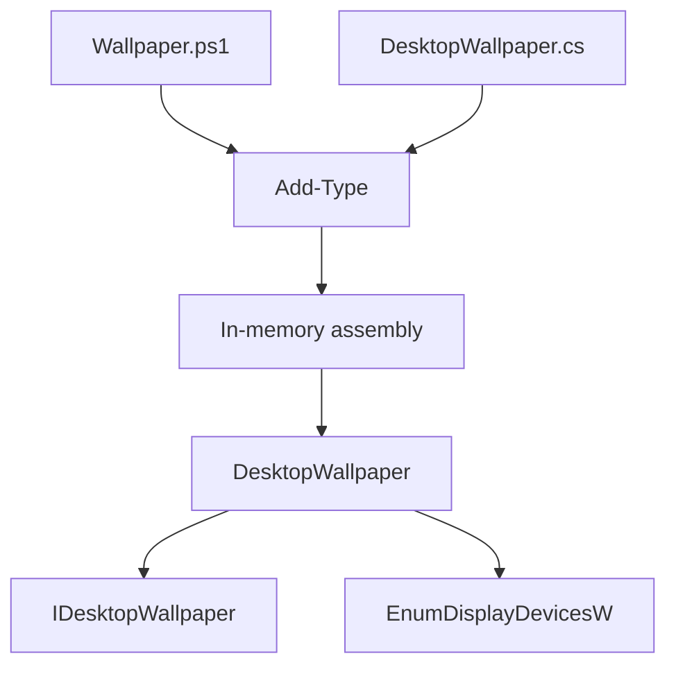

# Monitor Wallpaper Architecture

A Windows utility that randomizes wallpaper independently for each configured monitor.

## 1. Runtime architecture



Arrows show the main launch or dependency direction. The batch files and launcher start Windows PowerShell 5.1. The launcher hides the console and does not wait for the child process to exit.

| Layer | Module | Responsibility |
| --- | --- | --- |
| Entry points | Batch files | Launch PowerShell and forward exit codes. |
| Entry points | [Launcher.cs](internal/Launcher.cs) | Launch PowerShell without a console window. Built as MonitorWallpaper.exe. |
| Application | [Wallpaper.ps1](internal/Wallpaper.ps1) | Dispatch actions, read configuration, select images, manage shortcuts, synchronize execution, and record results. |
| Windows integration | [DesktopWallpaper.cs](internal/DesktopWallpaper.cs) | Identify monitors and get or set wallpaper. Calls EnumDisplayDevicesW and IDesktopWallpaper. |
| Windows integration | .NET / Windows Shell | File operations, named mutex, and shortcut management via WScript.Shell (COM). |

### Action routing

| Entry point | Action |
| --- | --- |
| [Setup.bat](Setup.bat) | Setup |
| [Reroll.bat](Reroll.bat) | Apply |
| [StopStartup.bat](StopStartup.bat) | StopStartup |
| Start menu shortcut | Apply |
| Startup shortcut | Startup |

The four actions are branches within Wallpaper.ps1, not separate scripts.

| Action | Responsibility |
| --- | --- |
| Setup | Validate configuration and image folders, build the launcher, register shortcuts, and remove the matching legacy startup registration. |
| Apply | Change wallpaper for monitors configured as random. |
| Startup | Apply wallpaper at sign-in; wait up to 20 seconds for missing monitors. |
| StopStartup | Remove current and legacy startup shortcuts only if their targets match the corresponding launchers. Keep the manual shortcut and executable. |

## 2. Build architecture

The launcher is built locally when Setup runs. Visual Studio and a separate .NET SDK are not required for this Windows PowerShell 5.1 build path.



Windows PowerShell 5.1 uses the .NET Framework C# compilation infrastructure. The resulting launcher is a managed Windows GUI executable, rather than a console application.

The build command in Wallpaper.ps1 is:

```powershell
Add-Type -LiteralPath (Join-Path $PSScriptRoot 'Launcher.cs') `
    -ReferencedAssemblies 'System.Windows.Forms.dll' `
    -OutputAssembly $temporaryLauncher `
    -OutputType WindowsApplication
```

| Build option | Purpose |
| --- | --- |
| LiteralPath | Select the C# source file. |
| ReferencedAssemblies | Reference Windows Forms for warning dialogs. |
| OutputAssembly | Write a temporary executable with a unique name. |
| OutputType | Generate a Windows GUI application. |

Setup moves or replaces the temporary executable at the final path, then creates the Start menu and Startup shortcuts using WScript.Shell. Both shortcuts target MonitorWallpaper.exe and pass the absolute Wallpaper.ps1 path and the corresponding action.

### Installed launcher



The launcher uses Process.Start with UseShellExecute set to false and CreateNoWindow set to true. It also passes the script's Hidden switch.

## 3. In-memory compilation

DesktopWallpaper.cs is compiled separately when Apply or Startup needs to change wallpaper. Unlike the launcher, it is loaded into the existing PowerShell process.



PowerShell creates an instance of the compiled class and calls its methods directly. No separate wallpaper worker EXE is generated.

| | Launcher.cs | DesktopWallpaper.cs |
| --- | --- | --- |
| When compiled | Setup | Apply or Startup, when needed |
| Build output | Windows GUI EXE | In-memory assembly |
| Execution | Separate process | Inside PowerShell |
| Purpose | Start PowerShell | Access Windows APIs and COM |

## 4. Shared resources and synchronization

All four actions acquire the same session-local named mutex (`Local\Freely.MonitorWallpaper`) before entering their main processing block. The lock is retained through execution and, for wallpaper changes, log writing. The acquisition timeout is 30 seconds.

The legacy mutex name is deliberately retained for compatibility with older copies of the tool.

| Resource | Location or behavior |
| --- | --- |
| Default configuration | [config.txt](config.txt) |
| Local override | config.local.txt, when present |
| Installed launcher | `%LOCALAPPDATA%\MyTools\MonitorWallpaper\MonitorWallpaper.exe` |
| Run logs | last-reroll.txt and last-startup.txt in the same data folder |
| Shortcuts | Current user's Start menu and Startup folders |

Shortcuts reference the folder where Setup was run. If the tool is moved, run Setup.bat from the new location to update the registration.
