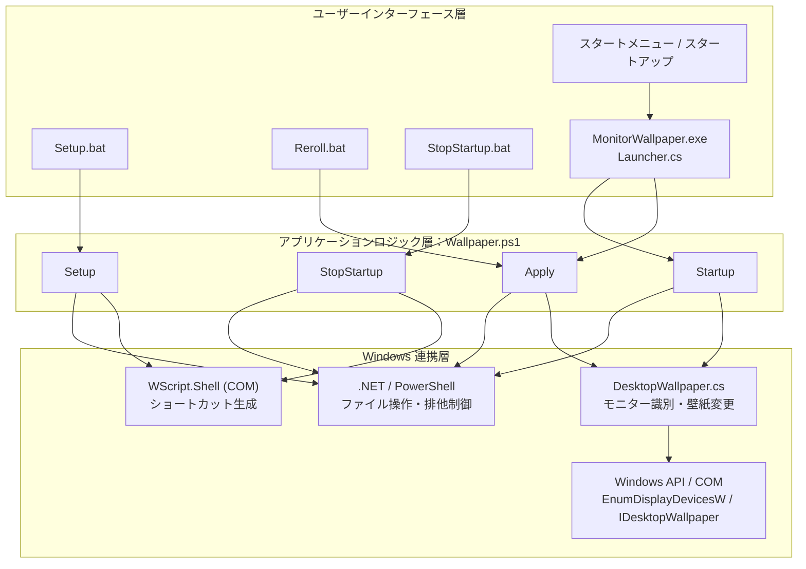

# アーキテクチャ

モニターごとの壁紙をランダムに変更するツール。起動インターフェース、アプリケーションロジック、Windows 連携の3層に責務を分離している。

## 全体構成

矢印は主な呼び出し・依存関係を示す。4つの Action は独立したファイルではなく、共通スクリプト内の処理分岐である。

## 各層の責務

| 層 | モジュール | 責務 |
| --- | --- | --- |
| ユーザーインターフェース | [Setup.bat](Setup.bat)、[Reroll.bat](Reroll.bat)、[StopStartup.bat](StopStartup.bat) | PowerShell の起動、Action の指定、終了コードの伝搬 |
| ユーザーインターフェース | [Launcher.cs](internal/Launcher.cs) | Setup 時に MonitorWallpaper.exe として生成され、ショートカットから PowerShell をコンソール非表示で起動 |
| アプリケーションロジック | [Wallpaper.ps1](internal/Wallpaper.ps1) | 設定読み込み、Action の振り分け、画像選択、ショートカット管理、排他制御、実行結果の記録 |
| Windows 連携 | [DesktopWallpaper.cs](internal/DesktopWallpaper.cs) | Windows API と COM を利用したモニター識別、壁紙の取得・設定 |
| Windows 連携 | WScript.Shell / .NET / PowerShell | ショートカットの作成と参照、ファイル操作、名前付き Mutex などの OS・ランタイム機能 |

## Action 一覧

| Action | 起動元 | 処理 |
| --- | --- | --- |
| Setup | Setup.bat | 設定と画像フォルダーを検証し、ランチャーとショートカットを生成して旧版のスタートアップ登録を置き換える |
| Apply | Reroll.bat / スタートメニュー | 設定に従い、対象モニターの壁紙を変更 |
| Startup | Windows サインイン時 | モニターの認識を必要に応じて待機し、壁紙を変更 |
| StopStartup | StopStartup.bat | スタートアップのショートカットのみ削除 |

設定は [config.txt](config.txt) に記述する。同じフォルダーに `config.local.txt` がある場合は、Setup・Apply・Startup がそちらを読み込む。すべての Action は名前付き Mutex によって排他制御される。

ランチャーと実行記録は `%LOCALAPPDATA%\MyTools\MonitorWallpaper` に置く。ショートカットは Setup を実行したフォルダーを参照するため、移動後は移動先の `Setup.bat` で登録を更新する。
